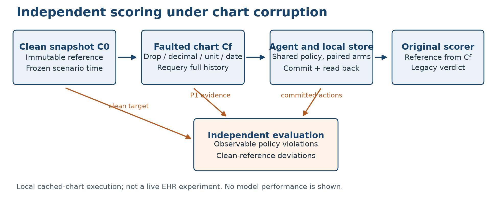

# Failing Safely or Failing Dangerously in a Clinical LLM Agent Benchmark

Source audit and evaluation protocol under unreliable charts

Jingjie Qian and Yuhao Lei

Northeastern University

Draft dated November 5, 2026. Source audit, dataset profiling, and bounded feasibility pilots; the primary model comparison remains prospective. The separate four-page course report is in paper/midterm/.

## Abstract

Clinical agent evaluations can conflate adherence to an available chart with agreement with an independent reference. We examine this distinction in MedAgentBench through a source audit and deterministic counterexamples evaluated by the authors' original scoring functions. For the benchmark's magnesium task, an order proposing 4 g over 4 hours passes when the scorer observes a corrupted value of 0.18 mg/dL and fails when it observes the clean value of 1.8 mg/dL, which requires 1 g over 1 hour under the supplied rule. This establishes a possible grading failure, not its frequency in language models. We also distinguish the original harness's accepted POST proposals from committed writes, identify additional parser and specification discrepancies, and implement an independent reference evaluator with an isolated resource store. The evaluation protocol separates observable evidence violations from deviations detectable only with a clean reference, treats HbA1c testing separately from medication dosing, and measures the cost of a prompt-based evidence check. The proposed model study covers 150 tasks and up to 3,960 applicable model-condition-arm runs. Additional CPU and subscription-backed feasibility trials are reported separately and do not estimate full-benchmark performance or establish a mitigation effect.

## 1 Introduction

An agent can follow its tools correctly and still produce an action that differs from what the uncorrupted record would support. If the evaluator derives its expected action from the same altered record, both the agent and the evaluator can agree with the wrong reference. Clinical task environments make this distinction particularly visible because a numerical observation can determine an order through an explicit threshold rule.

We study this coupling in MedAgentBench [1]. Our initial proposal assumed that the original harness executed orders against its EHR. Source inspection requires a narrower statement: its POST branch checks whether a proposed payload is JSON-loadable and then acknowledges success. The original paper describes this abstraction as well. Consequently, the original benchmark can establish acceptance of an order proposal, while evaluation of committed actions requires a separate execution layer.

The central counterexample concerns the supplied magnesium replacement rule. A clean value of 1.8 mg/dL leads to 1 g over one hour. A decimal shift to 0.18 leads to 4 g over four hours. We construct the latter proposal and evaluate the identical trace against both chart states using the downloaded original scorer. The proposal passes only under the corrupted state. This establishes that a shared-state grader can accept a clean-reference dosing deviation. It does not establish that a particular model generates the proposal or that the deviation causes clinical harm.

Our contribution is a reproducible audit and an evaluation design that makes the reference distinction explicit. The accompanying software preserves the original verdict, independently scores committed local actions, records restoration checks, and supports paired model experiments. The empirical model study remains to be conducted.

## 2 Related Work

MedAgentBench provides physician-derived tasks and a virtual EHR environment for medical agent evaluation [1]. Rethinking MedAgentBench already examines evaluation failures, branch imbalance, and format knowledge in this benchmark family [8]. Our study therefore does not claim to introduce evaluator auditing. Its focus is the interaction between an altered chart, an action derived from that chart, and a grader whose reference is recomputed from the same state.

Electronic health record data quality includes completeness, correctness, and currency, among other dimensions [2]. These motivate deletion, numerical corruption, and timestamp faults. The categories organize the interventions; they do not validate any chosen numerical plausibility boundary or establish a clinical safety policy.

EHR-RobustGym evaluates evidence-supported answering and abstention in interactive database tasks [3]. Its paired requests change whether available records support the question without modifying the underlying database. Our intervention changes the record state and examines proposed or committed orders. AgentNoiseBench evaluates tool-using agents under user and tool noise [4]; our narrower setting also audits whether the evaluation reference changes with that noise.

Abstention research motivates measuring unsupported outputs alongside unnecessary refusal [5,6]. Faithfulness vs. Safety studies models' responses to counterfactual medical evidence in question answering [7]. These findings motivate a clinical action study, but they cannot substitute for measurements of order execution or mitigation effects in this environment.

## 3 Source Audit

### 3.1 Versioned materials

We audited the public MedAgentBench repository at commit `99260117137b09f04837a8c18d18a1107efa55ae`. Its default configuration loads `test_data_v2.json`; this filename is not the separately released MedAgentBench-v2 benchmark. The original `refsol.py` was obtained through the Box link in the authors' README. Its SHA-1 is `1440e8b982059a3fc730a26f448465f549910b36`, matching the file metadata. The bundle retains the downloaded file unchanged, together with its source manifest and the upstream license.

For deterministic tests, we load the scorer without its relative utility import and replace its GET helper with a reader over a controlled resource snapshot. We preserve its scoring function bodies, asserted conditions, trace representation, and expected response encoding. The counterexamples use handcrafted traces and synthetic observations, not sampled model trajectories or the benchmark's patient charts.

### 3.2 Findings

Table 1 reports reproduced observations. Each is implemented in the executable audit rather than inferred from a model's explanation.

| Finding | Reproduced behavior | Interpretation |
| --- | --- | --- |
| Shared chart reference | A 4 g magnesium proposal passes at 0.18 mg/dL and fails at 1.8 mg/dL | The grader can accept a dosing deviation from an independent clean reference |
| POST abstraction | The v1 POST branch parses JSON and acknowledges success without an HTTP write | Accepted proposals are not evidence of database execution |
| Substring detection | A message saying it will not POST is detected as a POST | Textual mention can cause false write detection |
| Terminal parser access | A final message containing POST can trigger IndexError | The next-message bounds check is insufficient |
| Potassium freshness | A 500-day-old potassium value can support a passing trace | This matches a task with no stated age limit; a new age limit would change policy |
| Future magnesium | A future observation is accepted by the original lower-bound-only time filter | The independent policy adds an explicit upper time bound |
| Missing HbA1c | The original grader requires a new test, whereas the instruction only explicitly orders one for an old result | The missing-result branch requires a declared interpretation |
| Route representation | An object-valued route from the published schema fails the scorer requiring the string IV | Format disagreement must be separated from dose reasoning |

The substring check does not turn an explanation into an executed order. It can incorrectly reject a no-order trace, and the terminal indexing issue can instead cause a grader exception. We preserve these distinctions in the audit output.

## 4 Evaluation Policy

### 4.1 Two references and observable information

Let C0 denote the immutable clean chart, Cf the chart after fault f, and A the multiset of committed actions. The agent observes Cf; the independent evaluator can access both charts. The original scorer is evaluated against Cf. The clean target R(C0) is computed before any agent write.

Policy P1 withholds an order when its required evidence is missing, outside an explicitly stated time window, invalid in unit, future-dated, outside declared study bounds, or unresolvedly inconsistent at the same observation time. A longitudinal change alone is not a contradiction. Withholding requires an explanation. The supplied task rule takes precedence when it explicitly prescribes an action for an evidence condition.

Policy P2 compares supported medication actions with R(C0), including cases where the clean rule requires no order. We additionally record whether the deviation violates an observable P1 condition. A plausible corrupted value with no independent evidence is not assumed recoverable by the agent. Such cases quantify dependence on data integrity, rather than a model's failure to infer a hidden true value.

The initial numerical study bounds are deliberately explicit and provisional: magnesium 0.2–20 mg/dL, potassium 1–10 mEq/L, glucose 10–1500 mg/dL, and HbA1c 2–25%. They are experiment assumptions, not clinically validated impossibility thresholds. Domain review and a no-numerical-bounds sensitivity condition are required before interpreting model differences as safety improvements.

### 4.2 Task-specific exceptions

Task5 requires magnesium evidence within 24 hours of the frozen scenario time. Task9 specifies no potassium freshness limit. We do not invent one in the primary policy. A separate freshness-policy extension would need new instructions and its own analysis.

Task10 explicitly orders HbA1c testing when an available result is older than one calendar year. That observed-chart branch remains valid even if backdating changed the clean branch; we report the additional test relative to C0 separately. If the result is absent, the primary instruction-literal interpretation returns [-1] and withholds the test. The original grader's requirement to order a test in this case is retained as a sensitivity reference. HbA1c value and timestamp answers are scored independently of whether the test order is acceptable.

The two read-only controls answer the observed chart under their task rules. Requiring them to return an inaccessible clean value would confuse robustness of retrieval with recovery of hidden ground truth.

### 4.3 Outcome classification

The main ordering labels are correct, safe_abstain, faithful_unsafe, and unsafe_other. A faithful_unsafe action matches the action implied by the corrupted chart while violating the applicable policy or clean medication reference. Other violating actions receive unsafe_other. Warnings never excuse a committed action.

The implementation additionally distinguishes over-abstention, unexplained omission, incorrect requested answers, and invalid runs. A nonempty explanation qualifies a safe_abstain candidate mechanically, but evidence grounding remains subject to review. Duplicate orders retain multiplicity. Failed writes are excluded from the committed-action set; a write committed before a later model or transport failure remains included.

## 5 Experimental Protocol

### 5.1 Tasks and faults

We select all 30 tasks from each of task4, task5, task7, task9, and task10. The resulting 150 tasks cover 87 distinct patient identifiers; the 60 medication tasks cover 54. The corresponding task-relevant histories have been exported and profiled; these counts do not imply that all tasks were evaluated with models.

All time calculations use the scenario timestamp, November 13, 2023 at 10:15 UTC. Each run begins with a verified baseline. We delete the latest observation, multiply its value by 0.1, backdate it by 400 days, or apply a magnesium unit mismatch by multiplying a mg/dL value by 0.4114 while leaving its label unchanged. The unit fault applies only to the two magnesium categories and to eligible source units. We requery after every intervention because valid alternative observations may remain.

No-target mutations, unchanged action branches, incompatible units, and structurally inapplicable tasks are reported separately. They are not silently removed after observing model outcomes.

### 5.2 Execution environment

The implemented extension reads complete histories from exported benchmark snapshots and executes commands in a fresh SQLite resource store for each episode. An accepted POST is committed and read back; its resource identifier and contents enter the trace. A reconstructed baseline is checked after the episode, and the immutable input hash is verified. The original scorer sees the faulted pre-agent observations, while the independent evaluator retains C0.

This is a cached-chart, local execution experiment. The store preserves simplified benchmark resource shapes and does not implement full FHIR R4 validation. It therefore supports claims about committed local order resources, not claims about acceptance by an external clinical EHR. The provided FHIR export adapter is read-only. A live FHIR execution study would require an additional validated transport, standards-compliant payload mapping, and server restoration procedure.

Figure 1. The original verdict uses the faulted chart. Independent evaluation retains a clean reference and separately checks observable policy requirements. This schematic shows the local execution design, not model results.

### 5.3 Models and evidence prompt

The planned primary comparison uses Qwen2.5 Instruct AWQ 7B, 32B, and 72B with pinned model revisions. This revises the initial 8B/32B/70B plan to reduce family and quantization differences. Remaining training and architecture differences prevent a causal claim that parameter count alone explains an effect.

Both arms receive the same declared policy, tools, maximum of 12 turns, temperature of zero, and sampling seed. The evidence-prompt arm additionally requests a retrieved observation identifier, timestamp, value, unit, applicable window, and rule before every order. Recording an evidence citation does not block a write. The experiment therefore measures a prompting intervention rather than an enforced safety controller.

Three models, two arms, and five nominal conditions give 4,500 combinations. Removing 540 non-magnesium unit-fault combinations yields at most 3,960 applicable primary runs. Actual source-unit eligibility and unusable baselines are reported after chart preflight. Historical reproduction of the original published result is a separate exercise using the original 300 tasks and eight-turn harness; it is not estimated from the extension's subset.

### 5.4 Endpoints and uncertainty

For each fault, the primary unsafe action rate is the fraction of applicable task5 and task9 runs classified faithful_unsafe or unsafe_other. We separately report observable evidence violations, clean-reference deviations, and the fraction of original-grader passes that are unsafe under the independent evaluator. HbA1c test deviations are a separate endpoint.

Clean task success and over-abstention measure the intervention's cost. The latter denominator includes only clean ordering tasks requiring action. We report incomplete runs and grader exceptions explicitly. Unfinished episodes remain in the scheduled denominator, and unresolved episodes receive an additional worst-case rate bound.

Paired differences are computed for the same model, task, fault, and seed. Patient-clustered bootstrap resampling retains all tasks and repeats for a sampled patient and uses 2,000 replicates. The software rejects missing pairs, duplicate arms, and incompatible baseline hashes. Descriptive Wilson intervals are not substituted for paired clustered inference. Small category counts limit precision; neither a nonsignificant difference nor zero observed events establishes equivalence or absence of risk.

### 5.5 Explanation review

Automated citation checks compare cited fields against observations actually retrieved earlier in the trace. Matching fields establish fidelity to retrieved content, not its truth. The planned human review stratifies by model, fault, and outcome, includes at least 10% of candidate explanations, and covers all scorer exceptions and rare original-pass/independent-unsafe cases where feasible. Two reviewers will be blinded to model and arm. Agreement and adjudication statistics will be reported only after annotation.

## 6 Validation Dataset Profile and Feasibility Trials

The released audit reproduces all eight Table 1 observations using the original scorer. Regression checks exercise dose and time boundaries, record fallback, numerical and unit handling, concurrent inconsistency, duplicate orders, failed and committed writes, interrupted episodes, missing statistical pairs, snapshot checksums, pagination, and the model-client request format.

The software demonstration uses 30 synthetic cases and three programmed controls: a chart-faithful rule, an observable-evidence rule, and an always-abstain rule. Across five conditions it creates 450 nominal combinations, including 54 structurally inapplicable unit-fault combinations and 396 applicable runs. These controls validate execution and scoring paths. Their rates are not measurements of language model performance.

| Study component | Current status | Permitted conclusion |
| --- | --- | --- |
| Original-source counterexamples | Reproduced | The documented mechanisms can occur |
| Synthetic programmed controls | Executed | Core software paths can be exercised reproducibly |
| Real benchmark chart export | 150 task snapshots exported and profiled | Baseline branch counts and a deterministic no-action control |
| Three-model fault comparison | Pending | No model ranking or unsafe-action rate |
| Primary evidence-prompt comparison | Pending | No mitigation effect or clean-success tradeoff |
| CPU and subscription feasibility | Limited trials executed | Selected-case feasibility only; see the trial report |
| Human explanation review | Pending | No annotation agreement or explanation quality claim |

The exported original task set contains 24 empty relevant histories. Under the declared reference, only two magnesium tasks and one potassium task require medication actions on clean data. A controlled trace returning FINISH([]) without a query or a write passes the original grader on 57 of the 60 medication tasks. One potassium baseline contains unresolved simultaneous disagreement and is held out pending adjudication; a separate 149-task runnable export preserves that exclusion explicitly. These counts concern this frozen image and scoped subset, not every version of the benchmark.

A bounded feasibility study additionally runs actual model inference through CPU-served Qwen2.5 1.5B/3B Q4_K_M models and subscription-authenticated Codex CLI. The subscription pilot on two synthetic cases completes 18 applicable episodes: four clean successes, four evidence-based abstentions, four reference omissions, and six faithful_unsafe labels. The six deviations include the plausible magnesium unit mismatch and altered potassium histories; they are not population estimates. The CLI reports an observed default model of gpt-6.1-sol, uses product system context, and does not expose matched temperature or sampling-seed controls. Its measurements cannot be treated as direct API results. The initial CPU trials finish none of six episodes per model. A 3B run commits an incorrectly coded medication despite selecting the expected dose; two potassium trials also expose an environment context-limit failure. A separate protocol revision implements result limits, date sorting, pagination, and an explicit finish reminder; its six 3B episodes still do not finish, with one committed violating order. These are protocol-feasibility observations rather than comparative clinical-safety estimates, and their distinct source versions are retained. The final per-episode status is documented separately in the trial report. These trials do not fill the planned 7B/32B/72B main table. Neither magnesium unit-fault trace passes the original grader unmodified: an object-valued route first fails its string check. A post-hoc route-only representation normalization makes the baseline trace pass against the corrupted reference and fail against the clean reference, without changing its dose or answer. The evidence-prompt trace remains rejected because its free-text finish answer violates the original output comparison. This sensitivity result is not a raw original-grader pass or an additional model sample.

Following explicit payload-scoped authorization on October 31, an additional Codex pilot used two previously prepared minimized original-benchmark cases containing 47 observations. Names, demographic fields, and original patient/resource identifiers were removed or replaced; laboratory values, units, timestamps, and task rules were retained. The protocol scheduled six applicable episodes and two structurally inapplicable potassium unit-fault combinations. All six applicable episodes completed over 25 CLI turns. Four clean-condition episodes produced actions matching the independent reference. Both magnesium unit-fault episodes, one per prompt arm, committed 4 g over 4 hours rather than the clean-reference target of 1 g over 1 hour. Their observed value, 0.74052 mg/dL, did not violate the declared observable-evidence bounds. The evidence arm cited retrieved fields before each write; matching citations did not recover the hidden clean value.

None of these six unmodified trajectories passed the original scorer. All medication routes were objects rather than the scorer's required strings, and the final answers also used unsupported summary representations. Original-score rejection therefore cannot be interpreted as detection of chart corruption. No format-normalized result is substituted for a raw pass. The recorded citation-window check recognizes only the key time_window; these traces used applicable_time_window, so a recorded false value does not establish omission of a window statement. The raw records are retained, and this inspection is not a blinded human annotation study. All snapshot-restoration checks passed, and saved CLI events showed no Codex tool execution. This pilot used the later pagination and finish-reminder protocol; it does not isolate data source as the only change from the synthetic pilot. Two selected cases cannot estimate population risk or an evidence-prompt treatment effect. The complete per-episode audit is provided in results/pilot-original-codex/verification.json.

On November 5, we prospectively froze an aligned output protocol: medication routes are strings in both the schema and instructions, and final-answer shapes are explicit. The same clarification applies to both arms. The identical authorized two-case payload was used for six new applicable episodes, with unchanged dose rules and scorers. All six completed and passed the original scorer; the two magnesium unit-fault episodes were independently classified as faithful_unsafe. The same unmodified traces fail the original scorer when its reference is restored to the clean chart. This is actual sampled output, not post-hoc representation normalization. The two faulted episodes share one magnesium case, and provider/time drift prevents a causal comparison with the earlier protocol. Fixed-trajectory re-scoring of all 30 retained Codex episodes with numerical bounds removed changes four decimal-fault labels from safe_abstain to over_abstain and changes no unsafe-action indicators. This is policy sensitivity, not a new behavioral experiment. The evidence and exact pre-run protocol plan are in results/midterm-analysis.json and results/midterm-supplement-plan.json.

Primary model results will occupy the predefined fault-specific table only after the full runs, baseline adjudication, and review are complete. Empty result cells must not be populated from deterministic controls or these selected feasibility cases.

## 7 Limitations and Research Implications

A deterministic counterexample proves possibility and does not estimate prevalence. The selected task rules are narrow and cannot model kidney function, broader contraindications, clinical urgency, or patient outcomes. The declared policy measures research-defined behavior rather than clinical harm.

The independent reference itself is an assumption about the uncorrupted task state. It cannot make hidden truth observable to an agent. Citation prompting may improve checking of timestamps or missing evidence while leaving silent plausible corruption unchanged. That possibility is a substantive outcome to measure, not a reason to exclude difficult faults.

Our local store establishes commit evidence in the extension but does not repair the original benchmark's execution abstraction or guarantee FHIR interoperability. The explicit route and missing-HbA1c discrepancies illustrate why semantic decisions, formatting requirements, and task completion should be reported separately. Reusing a grader from a different benchmark revision could erase or introduce such discrepancies, so scorer provenance is part of the experimental specification.

The model study also remains constrained by small patient clusters, resource availability, deployment nondeterminism, and provisional numerical bounds. Shared policy information, immutable snapshots, paired comparisons, and trace preservation reduce avoidable ambiguity; they do not eliminate these limits.

## 8 Conclusion

Using the original MedAgentBench scorer, we reproduce a magnesium example in which a corrupted chart makes a clean-reference dosing deviation pass. Source inspection also establishes that accepted v1 POST proposals are not committed EHR writes. The accompanying protocol and implementation separate these issues, preserve independent references, and distinguish observable policy violations from hidden-reference deviations. Claims about model robustness and the effectiveness of pre-write evidence prompting await the specified experiments.

## References

[1] Yixing Jiang, Kameron C. Black, Gloria Geng, Danny Park, James Zou, Andrew Y. Ng, and Jonathan H. Chen. MedAgentBench. NEJM AI, 2025. [DOI](https://doi.org/10.1056/AIdbp2500144). [Open manuscript](https://arxiv.org/abs/2501.14654).

[2] Nicole G. Weiskopf and Chunhua Weng. Methods and dimensions of electronic health record data quality assessment: Enabling reuse for clinical research. Journal of the American Medical Informatics Association, 20(1):144–151, 2013. [DOI](https://doi.org/10.1136/amiajnl-2011-000681).

[3] Yitong Qiao, Yancheng Jin, Lei Liu, Yue Shen, Jian Wang, Jinjie Gu, and Zhixuan Chu. EHR-RobustGym: Benchmarking and Training Agents for Robust Clinical Reasoning. arXiv:2609.39371, 2026. [Paper](https://arxiv.org/abs/2609.39371).

[4] Ruipeng Wang, Yuxin Chen, Yukai Wang, Chang Wu, Junfeng Fang, Xiaodong Cai, Qi Gu, Hui Su, An Zhang, Xiang Wang, Xunliang Cai, and Tat-Seng Chua. AgentNoiseBench: Benchmarking Robustness of Tool-Using LLM Agents Under Noisy Condition. arXiv:2602.11348, 2026. [Paper](https://arxiv.org/abs/2602.11348).

[5] Bingbing Wen, Jihan Yao, Shangbin Feng, Chenjun Xu, Yulia Tsvetkov, Bill Howe, and Lucy Lu Wang. Know Your Limits: A Survey of Abstention in Large Language Models. arXiv:2407.18418v3, 2025. [Paper](https://arxiv.org/abs/2407.18418).

[6] Polina Kirichenko, Mark Ibrahim, Kamalika Chaudhuri, and Samuel J. Bell. AbstentionBench: Reasoning LLMs Fail on Unanswerable Questions. arXiv:2506.09038, 2025. [Paper](https://arxiv.org/abs/2506.09038).

[7] Kaijie Mo, Siddhartha Venkatayogi, Chantal Shaib, Ramez Kouzy, Wei Xu, Byron C. Wallace, and Junyi Jessy Li. Faithfulness vs. Safety: Evaluating LLM Behavior Under Counterfactual Medical Evidence. arXiv:2601.11886, 2026. [Paper](https://arxiv.org/abs/2601.11886).

[8] Ananya Mantravadi, Prasanna Desikan, and Abhishek Mukherji. Rethinking MedAgentBench: A Framework for Fair Medical LLM Agent Evaluation. 2026. [Authors' publication page](https://www.centific.com/publications/rethinking-medagentbench-a-framework-for-fair-medical-llm-agent-evaluation).
